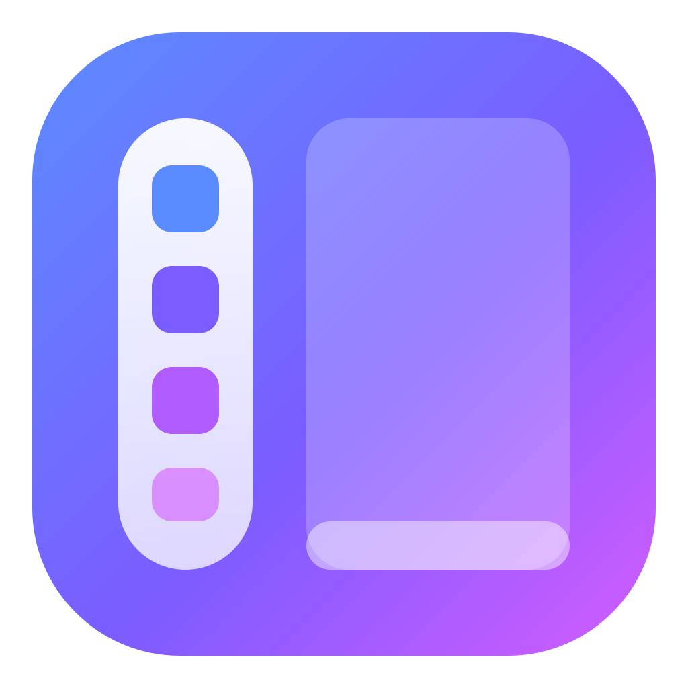

<p align="center">
  
</p>

<h1 align="center">SideDock</h1>

<p align="center">
  保留 Windows 原生任务栏的侧边停靠栏 · A side dock that keeps your Windows taskbar
</p>

<p align="center">
  <a href="#zh">中文</a> · <a href="#en">English</a>
</p>

---

<a name="zh"></a>

SideDock 是一个 Windows 桌面停靠栏。它的停靠栏部分移植自
[Seelen UI](https://github.com/eythaann/Seelen-UI) 的 SeelenWeg，但 **默认不会隐藏系统任务栏**：
停靠栏可以放在屏幕左侧（或任意一边），原生任务栏依旧留在底部，两者同时存在。
也可以选择用 SideDock 的精美工具栏代替任务栏——隐藏任务栏时桌面布局保持不变。

## 功能

- **停靠栏**（完整移植自 Seelen UI）
  - 左 / 右 / 上 / 下四个位置，全屏宽度或按内容自适应
  - 自动隐藏：从不（像任务栏一样占用屏幕空间，开关或调整时 Windows 可能重排桌面图标）/ 总是 / 与窗口重叠时，
    可调显示/隐藏延迟
  - 全屏应用（游戏、视频）处于前台时自动隐藏
  - 固定应用、文件、快捷方式；从资源管理器拖放即可固定；从 Windows 任务栏一键导入
  - 运行中的窗口按应用分组，打开/聚焦指示器，窗口计数，拆分窗口，窗口标题
  - 左中右三个分组 + 自定义分隔符，拖动排序，锁定任务栏
  - 新打开的程序默认出现在中间分组的末尾；右键停靠栏 >“新打开的程序显示在这里”可放一个虚线标记，
    运行中的程序会排在它后面，拖动标记即可改变位置
  - 类似 Mac 的波浪式放大：鼠标指向的图标放大并显示名称，前后图标平滑渐变
  - 应用太多时不再滚动：先缩小，再堆叠 / 继续缩小 / 折叠到“更多”按钮（可选）
  - 单击切换/最小化，多窗口弹出窗口列表，中键关闭或新建实例
  - 右键菜单：固定/取消固定、打开文件位置、以管理员身份运行、关闭、结束任务
  - 多显示器：仅主显示器或所有显示器
  - **窗口闪烁提醒**：应用请求注意时（新消息、下载完成等，原生任务栏按钮变橙色的情况），停靠栏上的图标会脉动几次，
    然后保持橙色，直到你切到那个窗口；辅助栏和文件夹堆栈上同样显示
  - **文件夹堆栈**：把几个固定的应用收进一个图标（右键应用 >“新建文件夹堆栈”或“移到堆栈”），图标显示其中四个应用，
    点击弹出网格；网格顶部可直接改名，每个应用可以“移出堆栈”，右键堆栈可解散。其中的应用在运行时，堆栈上同样有运行、
    焦点和闪烁提示，不会再出现重复的图标；设置页的“固定的应用”列表中会标出“已堆栈”
- **辅助停靠栏**：除主停靠栏外最多再加 3 个，各占一条边（主显示器），放你固定的应用、文件和模块，
  不显示运行中的程序。点击应用会切到它最近使用的窗口，没有运行则启动它
  - 模块与主停靠栏相同（开始菜单、时钟、媒体、电源、网络等），在辅助栏上右键“模块”或在设置页开关；
    每个停靠栏的模块互不影响
  - 每个辅助栏单独设置大小、宽度模式、自动隐藏方式和延迟（与主停靠栏相同，“从不隐藏”同样会占用屏幕空间并给出提示），
    以及放大效果（开关、最大放大倍数、每侧受影响的图标数、显示应用名称）和空间不足时的处理方式
  - 固定方式：设置页“辅助停靠栏”中添加，拖放到辅助栏上，或在启动台右键“固定到辅助栏”
  - 布局：左右两侧的栏占满整个高度，上下的栏位于它们之间；只有一个辅助栏且主停靠栏在顶部或底部时，
    主停靠栏保持整条边，侧边的辅助栏让开它。浮动的工具栏始终保持整条边，停靠栏排在它里面。
    把主停靠栏移到某个辅助栏所在的边，两者互换位置
  - 每个辅助栏是一个独立窗口（约 15–30 MB 内存）；自动隐藏的辅助栏在隐藏期间会释放内存
- **启动台（SideDock 开始菜单）**：类似 macOS Launchpad 的全屏启动台，支持拼音、首字母搜索，
  方向键 / 回车操作，右键固定到停靠栏或打开文件位置
  - **搜索不止应用**：同时按名称查找桌面、文档、下载、图片、音乐、视频和“最近使用”里的文件（可直接打开或打开所在位置）；
    输入 `12*(3+4)` 这样的算式直接得出结果，Enter 复制；输入 `github.com` 这样的网址直接打开；
    还可以一键用 Bing、Google、百度或 DuckDuckGo 搜索（可在设置中更换或关闭）。
    文件列表只保存在内存中，不写入磁盘，并跳过 `node_modules`、`.git` 等开发目录
  - 显示内容自己决定：全部应用，或“仅我添加的应用”（其余应用仍可通过搜索或“全部应用”找到并添加）；
    任何应用都可以右键“从启动台移除”
  - **合集**（类似 Windows 开始菜单的文件夹）：右键“新建合集”并命名，或把一个应用拖到另一个应用上；
    拖到合集上即加入，打开合集后可拖动排序、拖出合集、点击标题重命名，右键可解散
  - 拖动应用和合集即可排序，拖到屏幕左右边缘翻页
  - **底栏**（类似 Windows 开始菜单底部）：左侧是当前用户（账户设置、锁定、注销），右侧是快捷入口
    （设置、文件资源管理器、文档、下载、音乐、图片、视频、网络、个人文件夹，可在设置里选择显示哪些）
    和电源按钮（睡眠、关机、重启）。关机、重启、注销需要再点一次确认
  - 停靠栏 / 工具栏的开始按钮可以选择打开 Windows 开始菜单或启动台，也可以让 Win 键直接打开启动台
    （可选，需要一次管理员授权，见下方“Win 键接管”）
- **台前调度（窗口切换）**：默认 `` Alt+` ``，可自定义。中间是所选窗口的实时预览，左侧按应用分组列出所有窗口，
  窗口多时像停靠栏一样层叠；轻按后保持打开，单击左侧或下方的窗口会把它放到中间预览，
  单击中间的大窗口或双击才会切换过去；按住 Alt 连按则循环选择、松开即切换，滚轮切换同一应用的窗口
  - **最小化的窗口也能预览**：显示它最小化前的最后一帧（标注“已最小化”），按还原后的比例显示。
    Windows 不会为最小化的窗口继续绘制内容，所以画面停在最小化那一刻
  - **正在播放**：正在播放媒体的应用（例如最小化的视频）在窗口标题旁显示曲目名和上一首 / 播放暂停 / 下一首按钮，
    无需切换过去即可控制
- **精美工具栏**（参考 Seelen UI 的 Fancy Toolbar）：横贯屏幕的状态栏，包含开始按钮、当前应用名称、
  媒体控制、键盘布局、蓝牙、网络与音量（快速设置）、电池、时钟与日历、通知、任务管理器、显示桌面
  - **系统托盘图标可以平铺显示**在工具栏上（Seelen UI 做不到），单击 / 双击 / 右键 / 中键与在任务栏上完全一致；
    哪些平铺、哪些收进“^”弹窗由你决定：像 Windows 一样直接拖动图标（拖进弹窗即收起，拖回工具栏即平铺，
    工具栏上拖动可排序），也可以在设置里逐个开关，或一键“与 Windows 任务栏一致”。
    “^”弹窗的大小跟随收起的图标数量：每行最多 5 个，更多时向下增加行数。
    图标按应用给出的原始分辨率显示，和任务栏一样清晰。
    资源管理器自带的音量 / 网络 / 电源状态图标不会列出（Win11 下它们点击无效），由工具栏自己的
    “网络与音量”“电池”“通知”项目代替
  - **网络与音量是实时状态**：Wi-Fi 信号强度、有线、未连接、无 Internet，音量大小与静音都会反映在图标上；
    在图标上滚动鼠标滚轮调节音量（每格 2%），中键静音
  - “网络与音量”“通知”按钮是真正的开关：点一次打开 Windows 的快速设置 / 通知中心，再点一次关闭
    （SideDock 通过模拟系统快捷键 Win+A / Win+N 实现，见下方“工具栏与 Windows 面板”）
  - **永远不改变桌面布局**：工具栏从不占用屏幕空间（占用空间会让 Windows 重排桌面图标）。
    隐藏 Windows 任务栏且位于底部时，它正好占据任务栏原来的位置；其他情况下它浮在窗口上方，
    可设置为“与窗口重叠时隐藏”或“总是自动隐藏”（鼠标移到屏幕边缘时出现）
  - 工具栏比原生任务栏矮时，最大化窗口下方会留出一条任务栏的空间；“填补任务栏留下的空隙”可以让工具栏背景
    在有窗口贴到底部时（或一直）填满这块空间，按钮大小不变，桌面布局同样不受影响
  - 自由定制：左 / 中 / 右三个区域的项目（包括 CPU、内存、网速和自定义按钮）可拖动排列或隐藏，
    可调高度、内容大小（80%–140%）、显示/隐藏延迟
  - **独立主题**：可以跟随停靠栏，也可以单独选择五种主题之一并单独调节不透明度
  - **CPU、内存、网速**：可放到工具栏上的三个状态项目（内存提示里显示已用 / 总量，网速分下载和上传），
    点击打开任务管理器；只在工具栏上有这些项目时才每秒读取一次
  - **自定义按钮**：在工具栏上添加按钮，最多 24 个，可设置名称和图标（默认使用目标自己的图标）。三种类型：
    - **打开**：程序、文件、文件夹或网址，可带启动参数
    - **命令**：CMD 或 PowerShell 命令，支持多行；运行方式可选“保留窗口”“运行完关闭”“隐藏运行”，
      可勾选“以管理员身份运行”（每次会弹 UAC）和“运行前确认”
    - **注册表**：保存一个注册表路径（如 `HKCU\Software\Microsoft`，也接受 `HKEY_CURRENT_USER\...`、
      `计算机\...` 和 `/` 分隔），点击后注册表编辑器直接打开到该位置（见下方“数据目录”）
  - 全屏应用处于前台时自动隐藏
- **可选隐藏 Windows 任务栏，且不改变桌面布局**：只隐藏任务栏窗口本身，它保留的屏幕区域不变，
  桌面图标和最大化窗口不会移动（16:9、16:10 及其他比例的屏幕都一样，不会像 Seelen UI 那样重排桌面）。
  退出 SideDock、或 SideDock 意外退出时，任务栏都会自动恢复
- **模块**：开始菜单、显示桌面、回收站、时钟与日历、键盘布局选择器（跟随输入法的中 / 英状态）、媒体播放器、
  电源与电池、蓝牙、网络、通知、任务管理器
- **主页 / 设置**：玻璃（毛）、玻璃（清）、暗色、亮色、跟随系统五种主题，自定义强调色，中英文切换，开机自启，
  日志 / 用户数据 / 缓存的查看与清理卡片
- **备份与恢复**：在“数据与日志”页把设置、停靠栏与辅助栏项目、启动台布局备份为一个 JSON 文件，并显示备份位置。
  默认保存在 SideDock.exe 旁边的 `backups` 文件夹（第一次备份时才创建），也可以改到你选择的文件夹；
  可从列表或任意备份文件恢复，恢复前会自动备份当前设置，然后重启 SideDock 生效。
  手动删除或移动的备份会自动标为“已失效”，可以移除这条记录
- **快捷键**：全局快捷键可自定义（显示/隐藏停靠栏、打开设置、打开启动台、台前调度），
  录入时自动检测与 Windows 或其他程序的冲突
- **便携**：不写入 `C:\Users\...\AppData`，所有数据都在程序旁边的 `data` 文件夹
  （仅有的例外见下方“数据目录”，都是可选项）

## 稳定性设计

| 场景 | 处理方式 |
| --- | --- |
| 多次双击启动 | 单实例锁，重复启动只会唤起已运行实例的设置窗口 |
| 连续快速点击 | 启动 / 电源等操作在后端做节流，窗口创建有防重入保护 |
| 强制结束 / 崩溃 | 守护进程释放停靠栏占用的屏幕空间，并自动重启（2 分钟内超过 3 次则停止） |
| 写配置时断电或被杀 | 原子写入（临时文件 + 重命名）并保留 `.bak`，损坏时自动回退 |
| 隐藏任务栏时 SideDock 被强制结束 | 守护进程根据 `data/runtime/taskbar-hidden` 标记立即恢复任务栏 |
| 隐藏任务栏时 SideDock 卡住 | 只有在停靠栏或工具栏已经显示、且 SideDock 的窗口线程正常响应时才隐藏任务栏；窗口线程超过 8 秒无响应时任务栏自动回来，恢复后再隐藏 |
| 任务栏被另一份 SideDock 留在隐藏状态（例如连同守护进程一起被结束） | 任何一份 SideDock 启动时，如果自己的设置不隐藏任务栏，就把任务栏恢复显示 |
| 快速连续开关“隐藏任务栏” | 恢复时不依赖任务栏当前是否可见，一律请求显示，并在之后几秒内持续校验 |
| 资源管理器重启 | 自动重新隐藏任务栏、重新接入系统托盘，托盘图标由各应用自动重新登记 |
| 内存占用 | 弹窗、提示和启动台窗口常驻以保证秒开；闲置 30 秒后允许 WebView2 释放它们的内存，再次使用前自动取回。自动隐藏的辅助停靠栏同样处理 |
| 后台线程异常 | 监控线程出错会自动重启，不会拖垮整个程序 |
| 注销 / 关机 | 守护进程检测到系统正在关机时不会重新拉起 |

## 数据目录

```
SideDock.exe
sidedock_tray.dll   系统托盘接入组件（仅在开启工具栏托盘时由资源管理器加载）
backups/            配置备份（默认位置，第一次备份时才创建）
data/
  config/    settings.json、dock_items.json、aux_dock_items.json、launcher_layout.json（及 .bak 备份）
  logs/      滚动日志（每天一个，最多保留 10 个）
  userdata/  WebView2 配置文件
  cache/     应用图标缓存
  runtime/   会话锁、崩溃记录、任务栏隐藏标记、多行 CMD 命令按钮的批处理文件（commands/）
```

程序目录之外只有三处写入，都只在你使用对应功能时才会发生：

| 功能 | 写入位置 | 大小 |
| --- | --- | --- |
| 开机自启 | 注册表 `HKCU\Software\Microsoft\Windows\CurrentVersion\Run\SideDock` | 一个字符串值，关闭选项即删除 |
| 按 Win 键打开 SideDock 启动台 | 系统计划任务 `SideDock Win Key`（`C:\Windows\System32\Tasks\SideDock Win Key` 及对应注册表项） | 几 KB，关闭选项即删除 |
| 工具栏的“注册表”按钮 | 注册表 `HKCU\Software\Microsoft\Windows\CurrentVersion\Applets\Regedit\LastKey` | 一个字符串值 |

关于最后一项：注册表编辑器没有“打开到某个路径”的启动参数，它总是打开到上次关闭时所在的位置，
这个位置就记在 `LastKey` 里（注册表编辑器自己每次关闭时也会改写它）。SideDock 只在你点击“注册表”按钮时
把它改成按钮保存的路径，然后启动注册表编辑器；不写入其他任何注册表项。注册表编辑器本身需要管理员权限，
所以会弹出 UAC。如果注册表编辑器已经打开，SideDock 会把它切到前台并提示先关闭它（它只在启动时读取该位置）。

配置备份默认写在程序文件夹内的 `backups`；只有你在“数据与日志”页亲自选择了其他文件夹，备份才会写到那里。

### Win 键接管

Windows 11 不允许普通权限的程序阻止系统开始菜单弹出，因此这个选项由一个很小的**管理员辅助进程**
（`SideDock.exe --win-key-helper`）完成，它只负责监听 Win 键，SideDock 的其余部分仍以普通权限运行。

- 打开选项时会弹出一次 UAC，用来登记计划任务 `SideDock Win Key`。之后 SideDock 通过这个任务以管理员权限
  启动辅助进程，不再弹窗。
- 这个任务**没有任何触发器**：不会开机自动运行，只在 SideDock 运行并开启该选项时由 SideDock 启动；
  SideDock 退出或崩溃时辅助进程立即退出。
- 辅助进程不记录、不保存、不向外传输任何按键内容，只判断 Win 键是否被单独按下。Win + 其他键全部交还给系统。
- 关闭选项会停止辅助进程并删除该计划任务（可能会再弹一次 UAC）。
- **删除或移动 SideDock 文件夹前，请先关闭此选项。** 移动文件夹后，设置页会提示重新授权；
  如果已经直接删除了文件夹，可以在“任务计划程序”中手动删除 `SideDock Win Key`。
- 管理员权限加全局键盘钩子的组合，可能被部分安全软件提示，这属于误报。

### 系统托盘是如何显示在工具栏上的

各个应用通过 `Shell_NotifyIcon` 把托盘图标登记给资源管理器的任务栏窗口。与 Seelen UI 相同，SideDock 用一个
窗口消息钩子把 `sidedock_tray.dll` 加载到资源管理器的任务栏线程中，它只把这些登记消息**复制一份**转发给
SideDock，原消息照常交给任务栏，任务栏和通知区域的行为完全不受影响。

- 只有开启“精美工具栏”且工具栏项目中包含“系统托盘”时才会加载；关闭选项或退出 SideDock 即卸载。
- “与 Windows 任务栏一致”只读取 Windows 自己保存的托盘设置（`HKCU\Control Panel\NotifyIconSettings`），不写入注册表。
- 该 DLL 不读取任何文件或按键，不需要管理员权限，也不会写入任何数据。
- SideDock 退出后资源管理器可能会短暂持有该 DLL，此时替换或删除 SideDock 文件夹若提示“文件被占用”，
  稍等几秒或重启资源管理器即可。

### 工具栏与 Windows 面板

- Windows 没有提供“关闭快速设置 / 通知中心”的接口，只有系统快捷键 Win+A、Win+N 是真正的开关。
  因此点击工具栏的“网络与音量”“通知”按钮时，SideDock 会**模拟按下这两个快捷键**。
  SideDock 只在你点击对应按钮时模拟系统快捷键，一共四处：打开 Windows 开始菜单（Win）、显示桌面（Win+D）、
  快速设置（Win+A）、通知中心（Win+N）。除此之外，只有开启“Win 键接管”时，辅助进程会在你单独按下 Win 键的
  瞬间补发一个没有任何作用的按键，用来阻止系统开始菜单弹出。
- 这些面板贴着任务栏顶边弹出，并且位于所有普通窗口之上。工具栏浮在可见任务栏上方时会被面板盖住一端，
  此时工具栏的内容会自动让开，按钮、托盘和时钟保持可见可点，面板关闭后回到原位。
  隐藏任务栏、让工具栏占据其位置时不会被遮挡。

## 使用

1. 从 Releases 下载 `SideDock_<版本>_x64_portable.zip`
2. 解压到任意 **你有写入权限** 的文件夹（例如 `D:\Apps\SideDock`），
   `SideDock.exe` 和 `sidedock_tray.dll` 需要放在同一个文件夹里
3. 运行 `SideDock.exe`。首次运行会打开设置主页；之后可通过托盘图标打开

从旧版本升级：退出旧版本，解压新版本，把旧文件夹里的 `data` 复制过来即可保留全部设置。

系统要求：Windows 10 / 11 x64，已安装 WebView2 Runtime（Windows 11 自带）。

## 开发

前置条件：Node.js 20+、Rust（stable）、Visual Studio 2022 C++ 生成工具。

```bash
npm install
npm run dev      # 开发模式（Vite 热重载 + Tauri）
npm run check    # 前端类型检查 + cargo check
npm run build    # 发布构建，输出到 release/
```

开发模式下数据写入仓库根目录的 `data/`（已被 git 忽略）。
可用环境变量 `SIDEDOCK_DATA_DIR` 指定其他数据目录。

项目结构见 [docs/ARCHITECTURE.md](docs/ARCHITECTURE.md)。

## 许可证

[GNU AGPL-3.0-or-later](LICENSE)。停靠栏的界面、状态逻辑与部分后端代码移植自
eythaann 的 [Seelen UI](https://github.com/eythaann/Seelen-UI)（同为 AGPL-3.0），
移植的文件在开头注明了来源。

---

<a name="en"></a>

# SideDock (English)

SideDock is a dock for the Windows desktop. Its dock is ported from the SeelenWeg of
[Seelen UI](https://github.com/eythaann/Seelen-UI), but **it does not hide the system taskbar by default**:
the dock sits on the left side of the screen (or any other edge) while the native taskbar stays at the
bottom, both at the same time. You can also let SideDock's fancy toolbar replace the taskbar; hiding the
taskbar does not change the desktop layout.

## Features

- **Dock** (a full port of Seelen UI's)
  - Left / right / top / bottom, full width or fitted to its content
  - Auto-hide: never (reserves screen space like the taskbar; turning it on or off or adjusting the dock may
    make Windows rearrange the desktop icons) / always / when a window overlaps it, with adjustable show and
    hide delays
  - Hides while a fullscreen app (game, video) is in the foreground
  - Pin apps, files and shortcuts; drop them from Explorer to pin; import the Windows taskbar's pins with one click
  - Running windows grouped by app, open / focused indicators, window count, split windows, window titles
  - Left, center and right groups with custom separators, drag to reorder, lock the dock
  - Newly opened apps appear at the end of the center group; right-click the dock > "Show new apps here" puts
    a dashed marker there instead, and running apps line up after it (drag the marker to move the place)
  - Mac-like wave magnification: the icon under the cursor grows and shows its name, its neighbors follow smoothly
  - Never scrolls when there are too many apps: icons shrink first, then stack / keep shrinking / collapse
    into a "more" button (your choice)
  - Click to switch or minimize, a window list for apps with several windows, middle click to close or to
    start a new instance
  - Context menu: pin / unpin, open file location, run as administrator, close, end task
  - Multiple monitors: primary only, or every monitor
  - **Attention**: when an app asks for attention (a new message, a finished download: the taskbar button
    turns orange), its dock icon pulses a few times, then stays orange until you switch to that window; extra
    docks and folder stacks show it too
  - **Folder stacks**: several pinned apps behind one icon (right-click an app > "New folder stack" or "Move
    to stack"). The icon shows four of them and opens a grid; rename it at the top of the grid, move apps back
    out, or right-click the stack to ungroup it. Running, focused and attention marks show on the stack, and
    its running apps get no duplicate icon; the settings' pinned apps list marks them "In stack"
- **Extra docks**: up to 3 more docks besides the main one, each on an edge of its own (on the primary
  monitor), holding the apps, files and modules you add, never running apps. Clicking an app brings its
  most recent window to the front, or starts it
  - The same modules as the main dock (start menu, clock, media, power, network...), from the dock's
    right-click "Modules" menu or the settings page; each dock has its own
  - Each has its own size, width mode, auto-hide mode and delays (the same as the main dock's; "never" also
    reserves screen space, with the same warning), its own magnification (on / off, largest scale, icons
    affected on each side, app names) and its own "when items do not fit" behavior
  - Pin from the "Extra docks" settings page, by dropping onto the dock, or with "Pin to extra dock" in the
    launcher's context menu
  - Layout: left and right docks span the full height and top and bottom docks fit between them; with a
    single extra dock and the main dock at the top or bottom, the main dock keeps its whole edge and a side
    dock makes room for it. A floating toolbar always keeps its whole edge and the docks go inside it.
    Moving the main dock onto an extra dock's edge swaps the two
  - Each extra dock is a window of its own (about 15–30 MB of memory); an auto-hidden one gives memory back while hidden
- **Launcher (SideDock start menu)**: a fullscreen launcher like macOS Launchpad, with search by name,
  pinyin or initials, arrow keys and Enter, right click to pin to the dock or open the file location
  - **Search beyond apps**: files of Desktop, Documents, Downloads, Pictures, Music, Videos and the recent
    items by name (open them or their folder); arithmetic such as `12*(3+4)` is calculated (Enter copies the
    result); addresses such as `github.com` open directly; a web search with Bing, Google, Baidu or DuckDuckGo
    (changeable or off in the settings). The file list lives in memory only, nothing is written to disk, and
    tool folders such as `node_modules` and `.git` are skipped
  - You decide what it shows: every app, or "only apps I added" (the others are still found by search or
    under "All apps", and can be added); any app can be removed with a right click
  - **Collections** (like the folders of the Windows start menu): right-click > "New collection" and name
    it, or drop one app onto another; drop apps on a collection to add them, open it to reorder, drag apps
    out or click its title to rename, right-click to ungroup
  - Drag apps and collections to reorder them; hold one at the left or right screen edge to turn the page
  - **Bottom bar** (like the bottom of the Windows start menu): the signed-in user on the left (account
    settings, lock, sign out), shortcuts on the right (Settings, File Explorer, Documents, Downloads, Music,
    Pictures, Videos, Network, personal folder; chosen in the settings) and the power button (sleep, shut
    down, restart). Shut down, restart and sign out need a second click
  - The start button of the dock / toolbar opens the Windows start menu or the launcher, and the Win key
    can open the launcher directly (optional, needs administrator rights once, see "Win key takeover")
- **Window switcher (stage manager)**: `` Alt+` `` by default, customizable. A live preview of the selected
  window in the center, every window grouped by app on the left, stacked like the dock's icons when there
  are many. After a tap it stays open: a click on a window on the left or below only moves it to the
  center; a click on the center window, or a double click, switches to it. Hold Alt and press the key
  repeatedly to cycle, release to switch; the wheel steps through the windows of the same app
  - **Minimized windows have a preview too**: their last frame before they were minimized (tagged
    "minimized"), in the proportions they are restored to. Windows does not keep drawing minimized windows,
    so the picture stops at the moment it was minimized
  - **Now playing**: the app playing media (a minimized video, say) shows the track and previous /
    play-pause / next buttons next to its window title, so you can control it without switching to it
- **Fancy toolbar** (after Seelen UI's Fancy Toolbar): a status bar across the screen with the start button,
  the current app's name, media controls, keyboard layout, Bluetooth, network & volume (quick settings),
  battery, clock and calendar, notifications, Task Manager, show desktop
  - **System tray icons can be shown inline** on the toolbar (Seelen UI cannot). Click, double click, right
    click and middle click work exactly as on the taskbar. You choose which icons stay on the toolbar and
    which go into the "^" flyout: drag them like on Windows (into the flyout to hide, back onto the toolbar
    to show, along the toolbar to reorder), switch them one by one in the settings, or use "Same as the
    Windows taskbar". The flyout is as large as the icons it holds: 5 per row at most, more icons add rows.
    Icons are shown at the resolution the application provides, as sharp as on the taskbar.
    Explorer's own volume / network / power status icons are not listed (they ignore clicks on Windows 11);
    the toolbar's "network & volume", "battery" and "notifications" items replace them
  - **Network and volume are live**: Wi-Fi signal strength, wired, not connected, no internet, volume level
    and mute all show on the icons; turn the mouse wheel over them to change the volume (2% per notch),
    middle click to mute
  - The "network & volume" and "notifications" buttons are real toggles: one click opens the Windows quick
    settings / notification center, another closes it (SideDock sends the system shortcuts Win+A / Win+N,
    see "The toolbar and the Windows flyouts")
  - **Never changes the desktop layout**: the toolbar never reserves screen space (reserving space makes
    Windows rearrange the desktop icons). At the bottom with the Windows taskbar hidden, it takes the
    taskbar's exact place; anywhere else it floats over windows and can "hide when a window overlaps it" or
    "always hide" (it comes back when the cursor reaches the screen edge)
  - A toolbar lower than the native taskbar leaves the rest of the taskbar's space empty under maximized
    windows; "Fill the taskbar's space" lets its background fill it while a window reaches the bottom (or
    always), the items keep their size and the desktop layout still does not change
  - Customizable: drag items (CPU, memory, network speed and custom buttons included) between the left,
    center and right sections or hide them; adjust the height, the content size (80%–140%) and the show /
    hide delays
  - **Its own theme**: same as the dock, or one of the five themes with its own opacity
  - **CPU, memory, network speed**: three status items for the toolbar (the memory tooltip shows used / total,
    network speed shows download and upload); a click opens Task Manager. They are read once a second, and
    only while one of them is on the toolbar
  - **Custom buttons**: up to 24 toolbar buttons with a name and an icon (the target's own icon by default),
    of three kinds:
    - **Open**: a program, file, folder or web address, with optional arguments
    - **Command**: a CMD or PowerShell command, several lines allowed; run it in a window that stays open,
      closes when done, or hidden; optionally as administrator (a UAC prompt each time) and after a
      confirmation
    - **Registry**: a saved registry path (such as `HKCU\Software\Microsoft`; `HKEY_CURRENT_USER\...`,
      `Computer\...` and `/` separators work too) that Registry Editor opens at (see "Data folder")
  - Hides while a fullscreen app is in the foreground
- **Optional: hide the Windows taskbar without changing the desktop layout**: only the taskbar window is
  hidden, the screen area it reserves stays, so desktop icons and maximized windows do not move (on 16:9,
  16:10 or any other screen; the desktop is not rearranged as it is with Seelen UI). The taskbar comes back
  when SideDock exits, even unexpectedly
- **Modules**: start menu, show desktop, recycle bin, clock and calendar, keyboard layout selector (follows
  the IME's Chinese / English mode), media player, power and battery, Bluetooth, network, notifications,
  Task Manager
- **Home / settings**: five themes (frosted glass, clear glass, dark, light, follow the system), custom
  accent color, Chinese and English, start with Windows, cards to view and clear logs / user data / cache
- **Backup & restore**: on the "Data & logs" page, back up the settings, dock and extra dock items and the
  launcher layout as one JSON file; the page shows where backups go. By default that is a `backups` folder
  next to SideDock.exe (created by the first backup), or a folder you choose. Restore from the list or from
  any backup file: the current settings are backed up first, then SideDock restarts. Backups deleted or moved
  by hand are marked as no longer valid, and their entries can be removed
- **Shortcuts**: customizable global shortcuts (show / hide the dock, open the settings, open the launcher,
  window switcher), with conflict detection against Windows and other programs while recording
- **Portable**: nothing is written to `C:\Users\...\AppData`; all data lives in the `data` folder next to
  the program (the only exceptions are listed under "Data folder", and all of them are optional)

## Built to be robust

| Situation | What happens |
| --- | --- |
| Started several times | Single-instance lock: another start only brings up the running instance's settings window |
| Fast repeated clicks | Launch, power and similar actions are throttled in the backend; window creation is guarded against re-entry |
| Killed / crashed | A guardian process releases the screen space reserved by the dock and restarts SideDock (it stops after more than 3 times in 2 minutes) |
| Power loss or kill while saving settings | Atomic writes (temporary file + rename) with a `.bak` copy; a damaged file falls back automatically |
| SideDock killed while the taskbar is hidden | The guardian restores the taskbar at once, from the `data/runtime/taskbar-hidden` marker |
| SideDock hangs while the taskbar is hidden | The taskbar is only hidden once a dock or the toolbar is on screen and SideDock's window thread responds; after 8 seconds without a response the taskbar comes back, and goes again when SideDock recovers |
| Taskbar left hidden by another SideDock copy (killed together with its guardian, say) | Any SideDock that starts without "hide the taskbar" shows it again |
| "Hide the taskbar" switched on and off quickly | Restoring never relies on the taskbar's current visibility: it always asks for it to be shown, and checks again for a few seconds |
| Explorer restarts | The taskbar is hidden again and the system tray is reconnected; applications register their tray icons again by themselves |
| Memory | The popup, tooltip and launcher windows stay alive to open instantly; after 30 seconds idle WebView2 may release their memory, and they get it back before they are used again. Auto-hidden extra docks do the same |
| A background thread fails | Watcher threads restart on errors and cannot take the whole program down |
| Sign out / shut down | The guardian does not restart SideDock while Windows is shutting down |

## Data folder

```
SideDock.exe
sidedock_tray.dll   system tray component (loaded by Explorer only while the toolbar shows the tray)
backups/            configuration backups (default place, created by the first backup)
data/
  config/    settings.json, dock_items.json, aux_dock_items.json, launcher_layout.json (and .bak copies)
  logs/      rolling logs (one per day, 10 kept at most)
  userdata/  WebView2 profile
  cache/     application icon cache
  runtime/   session lock, crash record, taskbar-hidden marker, batch files of multi-line CMD buttons (commands/)
```

Only three things are written outside the program folder, each only when you use the matching feature:

| Feature | Written to | Size |
| --- | --- | --- |
| Start with Windows | Registry `HKCU\Software\Microsoft\Windows\CurrentVersion\Run\SideDock` | one string value, removed when you turn the option off |
| Win key opens the SideDock launcher | Scheduled task `SideDock Win Key` (`C:\Windows\System32\Tasks\SideDock Win Key` and its registry entries) | a few KB, removed when you turn the option off |
| The toolbar's "Registry" buttons | Registry `HKCU\Software\Microsoft\Windows\CurrentVersion\Applets\Regedit\LastKey` | one string value |

About the last one: Registry Editor has no command line option to open at a path; it always opens where it
was when it was last closed, and that place is kept in `LastKey` (Registry Editor rewrites it itself every
time it closes). Only when you click a "Registry" button does SideDock set it to the button's path and start
Registry Editor; no other registry value is written. Registry Editor needs administrator rights, hence its
UAC prompt. If Registry Editor is already open, SideDock brings it to the front and asks you to close it
first (it reads that place only when it starts).

Configuration backups go to `backups` inside the program folder by default; they only go elsewhere when you
pick another folder yourself on the "Data & logs" page.

### Win key takeover

Windows 11 does not let a non-elevated program keep the system start menu from opening, so this option is
carried out by a tiny **administrator helper process** (`SideDock.exe --win-key-helper`). It only watches
the Win key; the rest of SideDock keeps running without elevation.

- Turning the option on shows one UAC prompt, to register the scheduled task `SideDock Win Key`. From then
  on SideDock starts the helper with administrator rights through that task, without further prompts.
- The task has **no trigger**: it never runs at startup, only when SideDock is running with the option on;
  the helper exits as soon as SideDock exits or crashes.
- The helper does not record, store or transmit what you type; it only decides whether the Win key was
  pressed alone. Win + other keys are all left to Windows.
- Turning the option off stops the helper and deletes the task (this may show one more UAC prompt).
- **Turn this option off before deleting or moving the SideDock folder.** After moving the folder, the
  settings page asks you to authorize again; if you already deleted the folder, delete `SideDock Win Key`
  by hand in Task Scheduler.
- Administrator rights combined with a global keyboard hook may be flagged by some security software;
  this is a false positive.

### How the system tray gets onto the toolbar

Applications register their tray icons with Explorer's taskbar window through `Shell_NotifyIcon`. Like
Seelen UI, SideDock uses a window message hook to load `sidedock_tray.dll` into Explorer's taskbar thread.
It only forwards **a copy** of those registrations to SideDock; the original messages still reach the
taskbar, whose behavior and notification area are not affected.

- It is loaded only while the fancy toolbar is on and its items include "System tray"; turning the option
  off or exiting SideDock unloads it.
- "Same as the Windows taskbar" only reads the tray settings Windows keeps
  (`HKCU\Control Panel\NotifyIconSettings`); nothing is written to the registry.
- The DLL reads no files and no keystrokes, needs no administrator rights and writes no data.
- Explorer may keep the DLL loaded for a moment after SideDock exits. If replacing or deleting the SideDock
  folder then reports "file in use", wait a few seconds or restart Explorer.

### The toolbar and the Windows flyouts

- Windows offers no way to close the quick settings / notification center; only the system shortcuts
  Win+A and Win+N really toggle them. So when you click the toolbar's "network & volume" or
  "notifications" button, SideDock **sends those shortcuts**.
  SideDock sends system shortcuts only when you click the matching button, in four places: the Windows
  start menu (Win), show desktop (Win+D), quick settings (Win+A) and the notification center (Win+N).
  Apart from that, only with "Win key takeover" on, the helper sends one key that does nothing at the
  moment you press the Win key alone, to keep the system start menu from opening.
- These flyouts open against the top edge of the taskbar, above every ordinary window. A toolbar floating
  above the visible taskbar gets one of its ends covered by them; its items then move aside so the
  buttons, the tray and the clock stay visible and clickable, and move back when the flyout closes.
  A toolbar in the hidden taskbar's place is not covered.

## Usage

1. Download `SideDock_<version>_x64_portable.zip` from Releases
2. Unzip it to any folder **you can write to** (for example `D:\Apps\SideDock`); keep `SideDock.exe` and
   `sidedock_tray.dll` in the same folder
3. Run `SideDock.exe`. The first run opens the settings home page; later, open it from the tray icon

Upgrading: exit the old version, unzip the new one and copy the `data` folder from the old folder to keep
all your settings.

Requirements: Windows 10 / 11 x64 with the WebView2 Runtime (included in Windows 11).

## Development

Prerequisites: Node.js 20+, Rust (stable), Visual Studio 2022 C++ build tools.

```bash
npm install
npm run dev      # development mode (Vite hot reload + Tauri)
npm run check    # frontend type check + cargo check
npm run build    # release build, output in release/
```

In development mode data is written to `data/` in the repository root (ignored by git).
The `SIDEDOCK_DATA_DIR` environment variable selects another data folder.

The project layout is described in [docs/ARCHITECTURE.md](docs/ARCHITECTURE.md).

## License

[GNU AGPL-3.0-or-later](LICENSE). The dock's interface, state logic and parts of the backend are ported
from eythaann's [Seelen UI](https://github.com/eythaann/Seelen-UI) (also AGPL-3.0); ported files say so at
the top.
